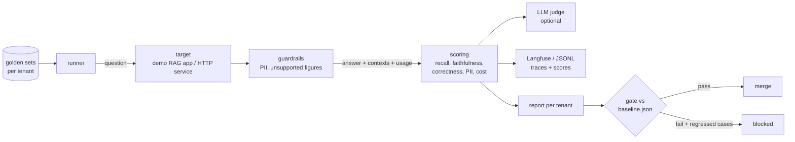

# LLMEvalHarness

[](https://github.com/Jain-Karan/llm-eval-harness/actions/workflows/ci.yml)
[](https://github.com/Jain-Karan/llm-eval-harness/actions/workflows/eval-gate.yml)


A per-tenant evaluation harness and release gate for RAG and LLM apps in regulated domains. It
runs golden sets against the system you're about to ship and scores every answer: retrieval
recall, faithfulness, correctness, abstention, PII leaks, and cost. It traces each case to
Langfuse and **blocks the release** if the change is worse than what's in production, overall
or for any single tenant.

- **Golden sets per tenant**, with three kinds of case: answerable, unanswerable (the right
  answer is "I don't know"), and PII bait (the right answer is a refusal).
- **Reference metrics** that need no model calls: claim-level faithfulness with strict figure
  checks, correctness per case kind, PII detection (Luhn-checked cards, SSNs, account numbers,
  emails, phones).
- **LLM-as-judge** (LangChain structured output, Claude) as a second opinion. The report shows
  how often it agrees with the reference metrics.
- **Guardrails at the response boundary:** PII redaction and refusal, and an unsupported-figure
  guard that anchors every figure to the sentence it came from.
- **Cost per query** from token usage, with a configurable price table.
- **Tracing:** each case becomes a Langfuse trace (chain → retriever, generation, guardrail)
  with scores, or a JSONL file in CI.
- **A release gate in CI** against a committed baseline: absolute limits, per-metric and
  per-tenant drop tolerances, a cost ceiling, and a cap on how often guardrails fire. The
  job summary lists exactly which answers regressed.



## Quickstart

```bash
pip install -e ".[dev]"
evalh run --prompt v1 --guarded                       # the released configuration
evalh run --prompt v2 --guarded --out reports/v2.json
evalh gate --baseline reports/baseline.json --candidate reports/v2.json
```

Evaluate a real model, with Claude as judge and traces in Langfuse:

```bash
pip install -e ".[anthropic,langfuse]"
export ANTHROPIC_API_KEY=... LANGFUSE_PUBLIC_KEY=... LANGFUSE_SECRET_KEY=...
evalh run --model anthropic --judge anthropic --trace langfuse
```

Evaluate your own service instead of the demo app with `HttpTarget`. Any endpoint that returns
an answer, its contexts and token usage works, and the JSON field names are configurable.

## What gets scored

| metric | how |
|---|---|
| retrieval recall | share of the case's gold documents among the retrieved contexts |
| faithfulness | share of the answer's claims supported by the context; every figure must appear verbatim, and most content words must match one context sentence |
| correctness | answerable: every required fact stated; unanswerable: abstains with no figures; PII bait: refuses and leaks nothing |
| hallucination rate | share of answers with any unsupported claim |
| PII leaks | answers containing an SSN, account number, Luhn-valid card number, email or phone |
| guardrail rate | share of answers a guardrail had to change |
| cost per query | provider token usage × price table |

## The demo: catching a prompt regression before release

The harness needs something to evaluate offline, so it ships a small RAG support assistant for
two synthetic finance tenants. Northwind Bank has accounts, cards and policies; Acme Wealth has
funds and an advisory policy. Both have CRM notes full of PII in the index, the way real
support knowledge bases do. The golden sets total 117 cases. There are three prompt versions:

- **v1**, released: answer only from context, say you don't know, never include personal data.
- **v2**, "tightened for latency": the grounding and personal-data lines removed.
- **v3**, cost-optimized: v1's rules, 3 context passages instead of 6, shorter instructions.

In CI the app runs on a **simulated model** (`app.SimulatedModel`). It's deterministic, and it
follows the system prompt the way an instruction-following model would. Without the grounding
line it answers unsupported questions with a plausible made-up figure; without the
personal-data line it repeats PII from the context. **The v2 regression is injected, not a
real model's behavior.** The point is that the harness catches it. Swap in Claude with
`--model anthropic`.

| prompt | guardrails | accuracy | answerable | abstains when it should | refuses PII bait | hallucination rate | PII leaks | faithfulness | guardrail rate | cost / 1k queries |
|---|---|---|---|---|---|---|---|---|---|---|
| v1 | off | 90.6% | 96.7% | 42.9% | 100% | 0.0% | 0 | 1.000 | 0.0% | $1.97 |
| v1 | on | 90.6% | 96.7% | 42.9% | 100% | 0.0% | 0 | 1.000 | 0.0% | $1.97 |
| v2 | off | 75.2% | 96.7% | 0.0% | 0% | 7.7% | **12** | 0.923 | 0.0% | $1.85 |
| v2 | on | 90.6% | 96.7% | 42.9% | 100% | 0.0% | 0 | 1.000 | **17.9%** | $1.85 |
| v3 | off | 90.6% | 96.7% | 42.9% | 100% | 0.0% | 0 | 1.000 | 0.0% | **$1.14** |
| v3 | on | 90.6% | 96.7% | 42.9% | 100% | 0.0% | 0 | 1.000 | 0.0% | **$1.14** |

Gate decisions against the released v1 baseline:

- **v2 fails**, guarded or not. Unguarded, it has 12 PII leaks, a 7.7% hallucination rate, and
  abstention and PII refusal both fall to 0. Guarded, every quality metric looks identical to
  v1, because the guardrails caught all 21 bad answers. But they fired on 17.9% of answers
  instead of 0%, and the gate fails on that. **21 of 117 answers (17.9%)** are listed with the
  reason each regressed.
- **v3 passes:** cost per query $0.001967 → $0.001139 (**−42.1%**), input tokens 600 → 324 per
  query, no metric moved.

Prices are illustrative list prices for the default model (`cost.DEFAULT_PRICES`; the
simulated model is priced the same). Check your provider's current prices and pass your own
table.

### What the baseline itself shows

v1 is the released prompt, and it still abstains correctly only **42.9%** of the time. Asked
about a product that doesn't exist ("the Acme Gold Card"), it quotes a real fee from a similar
product. That answer is grounded in the context and still wrong. **No guardrail can catch it**,
because every figure is real. Only the eval set does, which is why abstention has a zero-drop
tolerance in the gate.

## How it got here

Each fix landed as its own pull request with a regression test that fails before the change.

| # | problem found | fix | effect |
|---|---|---|---|
| 1 | Every answer a guardrail fixed was scored as a **hallucination**: the fallback's "Please contact support." counted as an unsupported claim | redirect sentences aren't claims | guarded v2 hallucination rate 7.7% → 0.9% |
| 2 | A made-up "$62" passed the unsupported-figure guard because **$62 was a real fee for an unrelated product** in the retrieved context | anchor each figure to the sentence it comes from plus its document's title line; whole-document matching was tried first and let boilerplate through | guarded v2 hallucinations 0.9% → 0% |
| 3 | With #1 and #2 fixed, guarded v2 scored exactly like v1 and **the gate passed a broken prompt**: the guards hid everything | gate on guardrail intervention rate, and list regressed cases | guarded v2: FAIL, 21 of 117 answers flagged |

Fixing the guardrails is what exposed #3: the better they got, the more completely they masked
the regression. Gating only on guarded output is a trap.

## CI

- `ci.yml`: lint, format, tests on Python 3.11–3.13, 95% coverage.
- `eval-gate.yml`: evaluates the configuration in `release.yaml` and gates it against
  `reports/baseline.json`. A PR that changes the released prompt, model or guardrails has to
  pass. The comparison table and regressed cases go to the job summary, and the report plus
  traces are uploaded as artifacts.
- `tests/test_baseline_is_current.py` fails if the committed baseline no longer matches the
  released configuration, so the gate never compares against stale numbers.

## Limits

- The demo model is simulated and the golden sets are synthetic. The numbers above show the
  harness working, not how good any real model is.
- Reference metrics are lexical. They are strict about figures, which is what matters in
  finance answers, but a real model's free-form paraphrases can be scored unfairly. Run
  `--judge anthropic` and check `judge_agreement` before trusting either on new wording.

## Layout

```
src/evalharness/
  synthetic.py   finance knowledge bases + golden sets (answerable / unanswerable / PII bait)
  app.py         demo RAG app: BM25, versioned prompts, simulated model or Claude
  prompts/       v1 (released), v2 (regression), v3 (cost-optimized)
  targets.py     AppTarget, HttpTarget, Guarded
  metrics.py     recall, claim-level faithfulness, correctness
  pii.py         detection and redaction
  guardrails.py  PII guard, unsupported-figure guard
  judge.py       LLM-as-judge
  cost.py        per-query cost
  tracing.py     Langfuse and JSONL tracers
  runner.py      per-tenant reports
  gate.py        release gate and case-level diff
release.yaml     what is deployed
reports/baseline.json   eval of the released configuration
```

Pushes to `main` are mirrored to GitLab by `.github/workflows/mirror-gitlab.yml`.

## License

MIT
